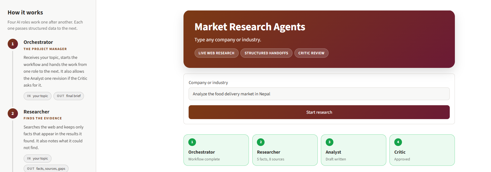
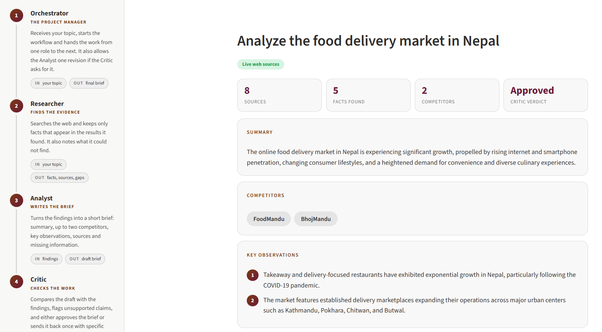
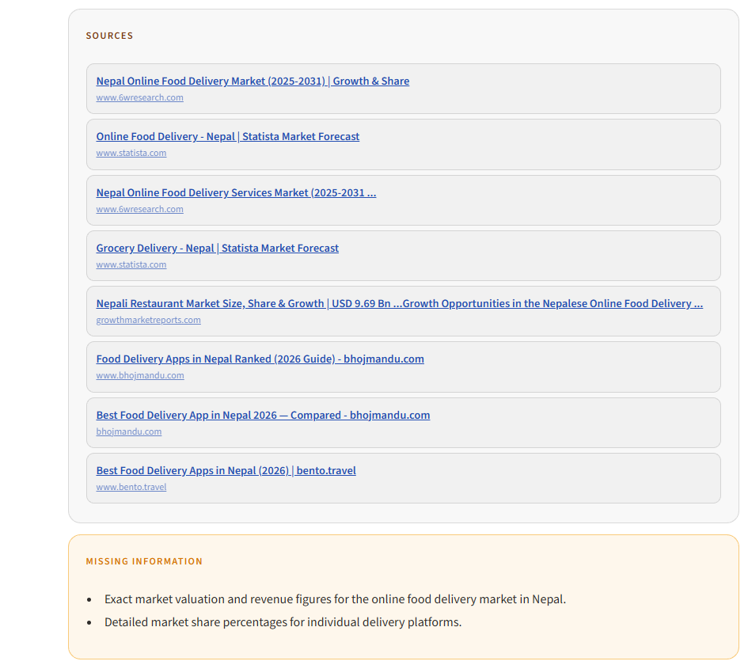
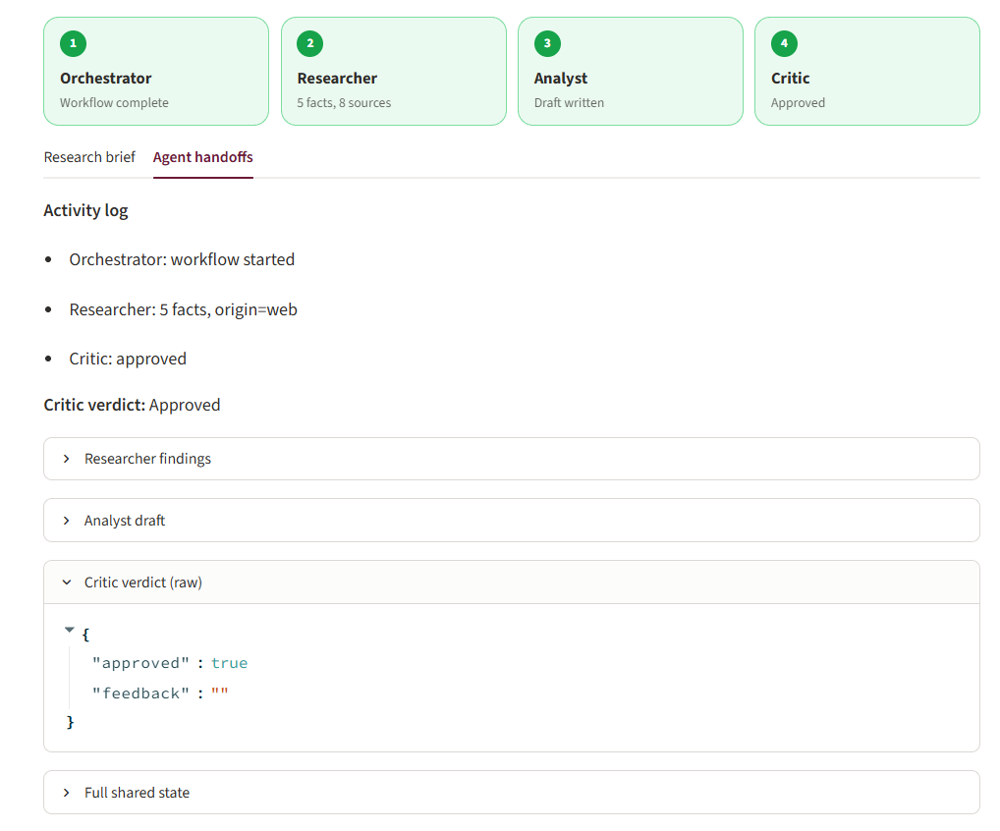
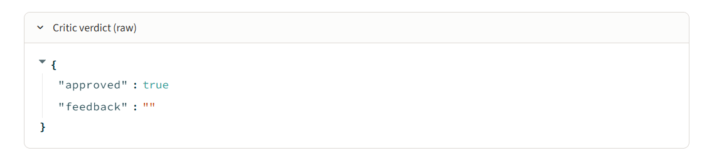

# Multi-Agent Market Research App

A small Streamlit web app. You type a company or industry (for example
"Analyze the food delivery market in Nepal"), and four AI roles work one after another to
produce a short research brief.

**Orchestrator -> Researcher -> Analyst -> Critic** (the Critic can request at most one revision)

All roles use the same language model: Google Gemini (free tier) by default, or Anthropic
Claude if only `ANTHROPIC_API_KEY` is set. Data moves between the roles as structured
Pydantic models.

## Works for any topic (Nepal is only an example)

The app accepts **any company or industry**, for example `Tesla`, `Online education in India`
or `Analyze the food delivery market in Nepal`. Nothing in the workflow is specific to Nepal.

The Nepal food delivery query is used only as the example in this README, in the screenshots and in
`sample_output.md`, because it is the example given in the assignment. For every topic the Researcher
uses live web search. The only Nepal-specific code is a small, clearly labelled **sample-data fallback**
in `search.py`: it is used only if live search returns nothing for that exact example query. For any
other topic, if search returns nothing, the app shows an error and does not make up content.

## What the app shows

A research brief with: a summary, up to two competitors, key observations, sources (with links)
and missing information. The **Agent handoffs** tab shows exactly what each role passed on,
including the Critic's feedback if a revision was requested.
An example result is in [`sample_output.md`](sample_output.md).

## Screenshots

**1. All four roles finished**



**2. The research brief** (summary, competitors, key observations)



**3. Sources and missing information**



**4. Agent handoffs** (role status, activity log, structured data)



**5. The Critic's raw verdict** (structured output passed back to the Orchestrator)



## The four roles

| Role | Job | Code |
|---|---|---|
| Orchestrator | Receives the topic, starts the workflow, runs the roles in order and allows one revision | `workflow.py` |
| Researcher | Searches the web (DuckDuckGo) and extracts facts only from the results it found; lists what is missing | `workflow.py`, `search.py` |
| Analyst | Writes the brief from the findings (and rewrites it once if the Critic asks) | `workflow.py` |
| Critic | Compares the draft with the findings; approves it or requests one revision | `workflow.py` |

The shared data models (`Findings`, `Brief`, `Critique`, `WorkflowState`) are in `models.py`.

---

## Run it on your computer (step by step)

### 1. What you need

- **Python 3.10 or newer.** Check with `python --version` (on Mac/Linux you may need `python3 --version`).
  Download from https://www.python.org/downloads/ if needed. On Windows, tick
  **"Add Python to PATH"** during installation.
- **A free Gemini API key** : open https://aistudio.google.com/apikey,
  sign in with a Google account, click **Create API key** and copy it.
- An internet connection (for web search and the AI model).

### 2. Download the project

```bash
git clone <YOUR-REPOSITORY-URL>
cd <repository-folder>
```

Or download the repository as a ZIP from GitHub, unzip it, and open a terminal inside the folder
that contains `app.py`.

### 3. Create a virtual environment

A virtual environment keeps this project's packages separate from the rest of your computer.

**Windows (PowerShell):**
```powershell
python -m venv .venv
.\.venv\Scripts\Activate.ps1
```
If PowerShell says scripts are disabled, run this once and activate again:
```powershell
Set-ExecutionPolicy -Scope Process -ExecutionPolicy RemoteSigned
```

**Windows (Command Prompt):**
```bat
python -m venv .venv
.venv\Scripts\activate.bat
```

**macOS / Linux:**
```bash
python3 -m venv .venv
source .venv/bin/activate
```

When it works, your prompt starts with `(.venv)`.

### 4. Install the packages

```bash
pip install -r requirements.txt
```

### 5. Add your API key

Create your own `.env` file from the template.

**Windows:**
```powershell
copy .env.example .env
notepad .env
```

**macOS / Linux:**
```bash
cp .env.example .env
nano .env
```

In `.env`, replace the placeholder so the line looks like this (no quotes, no spaces):

```
GEMINI_API_KEY=your-real-key-here
```

Save the file. **Never share or commit `.env`**: it contains your secret key. The repository
only contains `.env.example`, which has placeholder values.

### 6. Start the app

```bash
streamlit run app.py
```

Your browser opens at http://localhost:8501. If it does not, open that address yourself.

### 7. Use it

1. Type any company or industry into the box, for example `Analyze the food delivery market in Nepal`.
2. Press **Enter** or click **Start research**.
3. Watch the four roles finish (a run usually takes one to two minutes).
4. Read the brief. Open the **Agent handoffs** tab to see each role's data.
5. Click **Download brief (.md)** to save the result.

To stop the app, press `Ctrl + C` in the terminal.

Next time you only need to activate the virtual environment (step 3, second line) and run
`streamlit run app.py`.

---

## Troubleshooting

| Problem | Fix |
|---|---|
| `source` is not recognized (Windows) | `source` is for Mac/Linux. On Windows use `.\.venv\Scripts\Activate.ps1`. |
| `No API key found` | `.env` is missing, in the wrong folder, or the key line is wrong. It must be in the same folder as `app.py` and contain `GEMINI_API_KEY=...`. Restart the app after editing it. |
| `ModuleNotFoundError` | The virtual environment is not active or packages are not installed. Activate it and run `pip install -r requirements.txt`. |
| `429` or "quota used up" message | The Gemini free tier has a small daily quota per model (around 20 requests at the time of writing). One run uses 3 to 4 requests. The app automatically tries the next model in its list; when all are used up, wait for the daily reset or use another API key. |
| `404 model not found` | Model names change. Set `GEMINI_MODEL` in `.env` to a current model name from https://aistudio.google.com (see "Optional settings"). |
| `503 high demand` | Google's servers are busy. The app retries automatically; try again in a minute. |
| "Web search found nothing" | Check your internet connection or VPN and try again. Very short or unusual topics can return no results. |

## Optional settings

Set these in `.env` if you need them (see `.env.example`):

- `GEMINI_MODEL`: comma-separated model names, tried in order. Default:
  `gemini-3.5-flash,gemini-3.5-flash-lite,gemini-3.1-flash-lite`.
- `ANTHROPIC_API_KEY` and `ANTHROPIC_MODEL`: to use Claude instead. The app uses Gemini if
  `GEMINI_API_KEY` is set, otherwise Claude.

## Project files

```
app.py            Streamlit interface
workflow.py       Orchestrator, Researcher, Analyst, Critic
models.py         Pydantic models passed between the roles
search.py         Web search (with clearly labelled sample data for the Nepal food delivery example only)
llm.py            Model calls, retries and model fallback
requirements.txt  Python packages
.env.example      Template for your own .env (placeholders only)
sample_output.md  Example brief (Nepal food delivery market)
docs/             Screenshots used in this README
```

## Notes and limitations

- The Researcher works from search result snippets, not full web pages, so the brief reflects only
  that evidence. Anything it could not find is listed under **Missing information**.
- Company names appear only when the search snippets contain them. If none do, the brief says
  "None identified" instead of guessing.
- Some sources may be company-authored pages (for example a competitor's own blog), which can be
  promotional.
- The Critic requests a revision only when it finds a specific problem, so many runs finish with a
  single draft. The Analyst revises using the same findings (no new search), and the revision is
  capped at one (see `orchestrator()` in `workflow.py`).
- If web search returns nothing, the app only falls back to labelled **sample data** for the
  Nepal food delivery example. For any other topic it shows a clear error instead of made-up content.
- Results depend on what the search returns and on the model, so the same query can give slightly
  different briefs.
- Deployment is not included; the app is meant to run locally.
